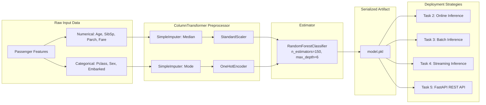
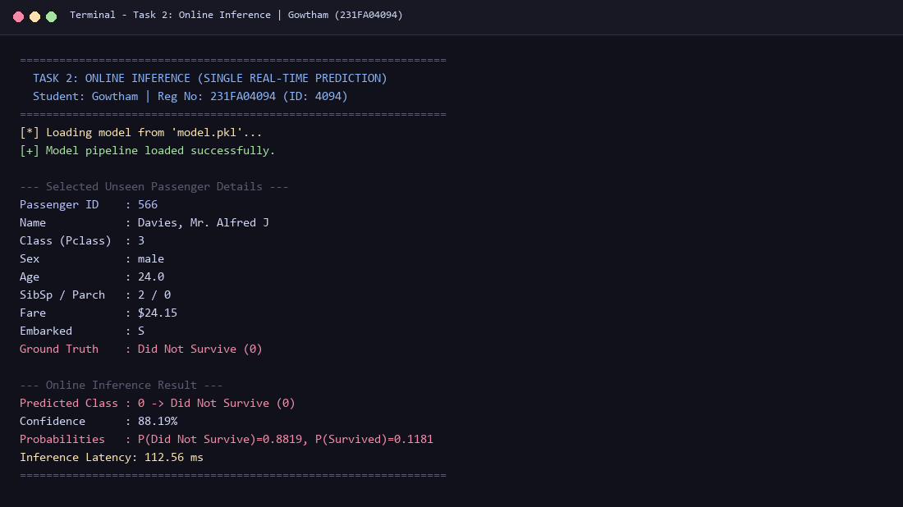
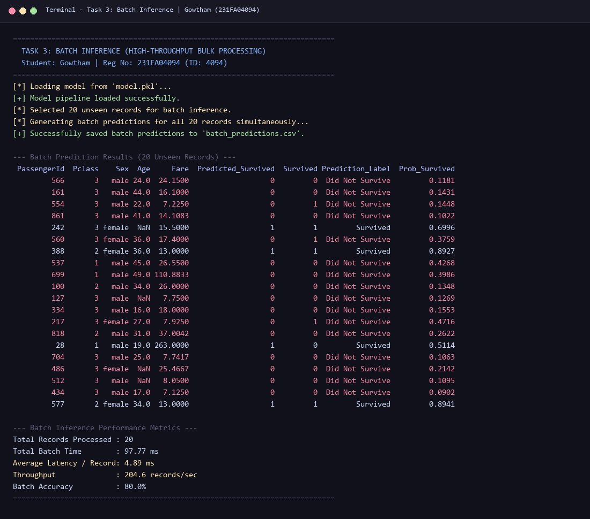
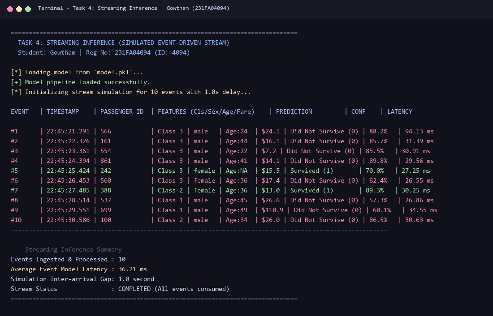
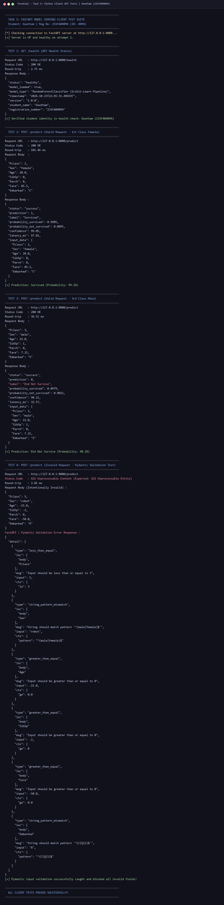
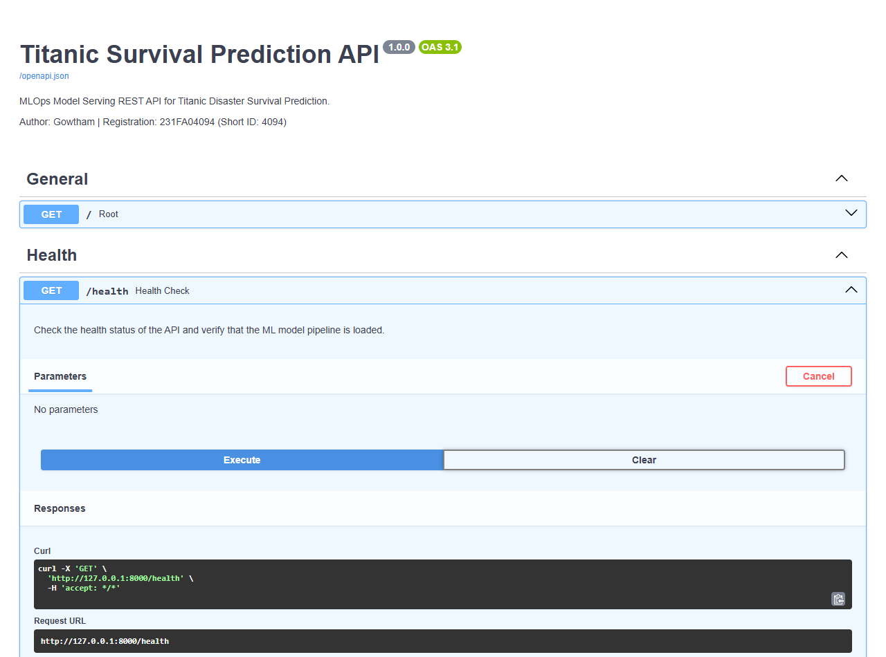
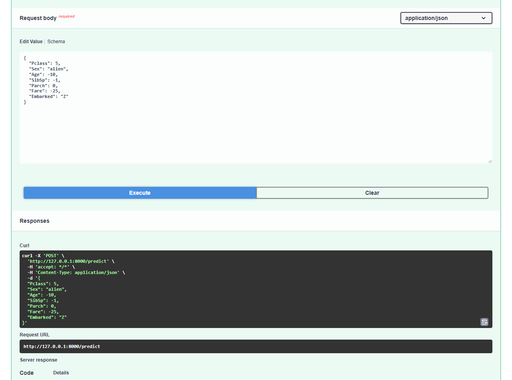
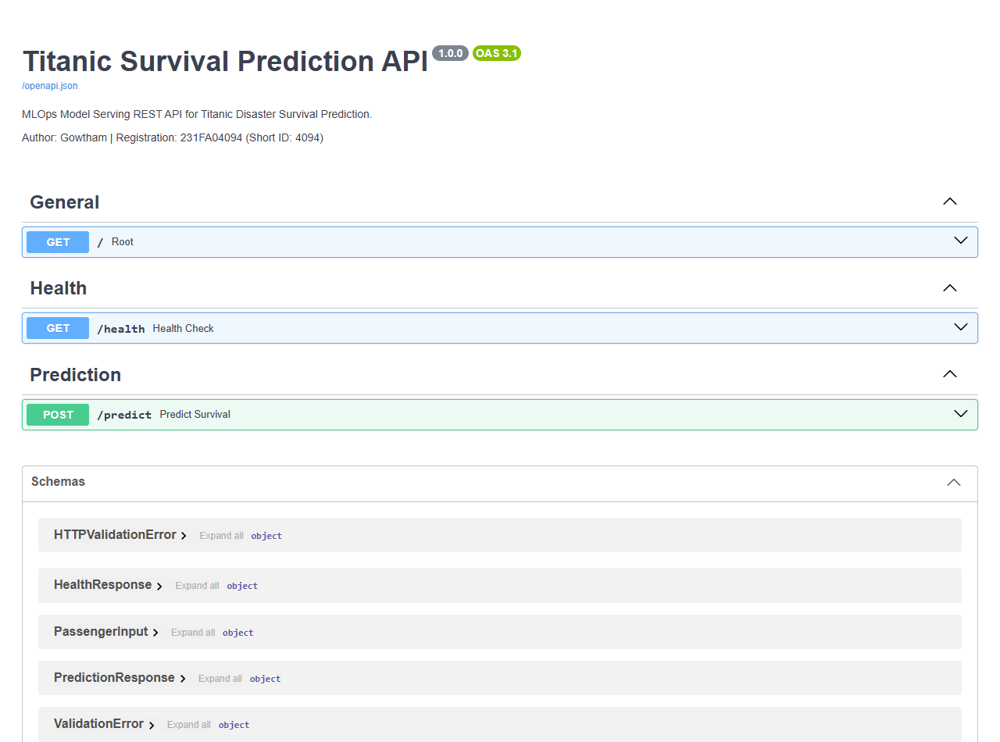

# ML Model Deployment Strategies and Model Serving using FastAPI


---

### Student Information
- **Student Name:** Gowtham
- **Registration Number:** 231FA04094
- **Short Registration Number:** 4094
- **Course / Assignment:** Continuous Learning Assignment 4 (CLA-4) — MLOps
- **Topic:** ML Model Deployment Strategies and Model Serving using FastAPI

---

## Project Overview

This repository demonstrates end-to-end Machine Learning model deployment, comparing three fundamental inference strategies (**Online**, **Batch**, and **Streaming**), and exposing the trained pipeline through a production-ready **REST API** using **FastAPI** and **Pydantic**.

The project uses the classic **Titanic: Machine Learning from Disaster** competition dataset from Kaggle to train a unified `scikit-learn` classification pipeline, eliminating training-serving skew by reusing the exact same serialized model across all deployment mechanisms.

- **Dataset Source:** [Kaggle Titanic Competition Data](https://www.kaggle.com/competitions/titanic/data)
- **Primary Data File:** `train.csv` (891 passenger records)
- **Evaluation Accuracy:** **80.45%** on held-out unseen test data

---

## Repository Structure

```text
MLops-CLA4-4094/
├── train.csv                     # Original Kaggle Titanic train dataset (891 records)
├── unseen_test_data.csv          # Held-out 20% unseen test records (179 records)
├── train.py                      # Task 1: Preprocessing pipeline, model training, evaluation & serialization
├── online_inference.py           # Task 2: Real-time single-record inference demonstration
├── batch_inference.py            # Task 3: Vectorized bulk inference for 20 records -> batch_predictions.csv
├── streaming_inference.py        # Task 4: Event-driven streaming inference simulation (1-second delay)
├── app.py                        # Task 5: FastAPI REST API service with Pydantic validation & Swagger UI
├── client.py                     # Task 5: Automated Python test client (valid & invalid requests)
├── capture_screenshots.py        # Automation utility for capturing terminal & Swagger UI screenshots
├── generate_report.py            # Generates academic PDF report with ReportLab
├── model.pkl                     # Serialized Scikit-Learn Pipeline (preprocessing + model)
├── batch_predictions.csv         # Generated batch predictions output (Task 3)
├── requirements.txt              # Pinned Python package dependencies
├── MLOps_Assignment_Report.pdf   # Brief PDF report containing observations & architecture
├── README.md                     # Comprehensive documentation, execution steps, and results
├── submission.zip                # Single archive containing all deliverables for submission
└── screenshots/                  # High-resolution visual proof of execution
    ├── online_inference.png               # Task 2: Online inference console output
    ├── batch_inference.png                # Task 3: Batch inference console output
    ├── streaming_inference.png            # Task 4: Streaming inference console output
    ├── python_client_test.png             # Task 5: Client test suite output
    ├── fastapi_swagger_overview.png       # Task 5: Swagger UI overview (/docs)
    ├── fastapi_health_swagger.png         # Task 5: Swagger UI /health test (200 OK)
    ├── fastapi_predict_valid_swagger.png  # Task 5: Swagger UI /predict valid test (200 OK)
    └── fastapi_predict_invalid_swagger.png# Task 5: Swagger UI /predict invalid test (422 Unprocessable)
```

---

## Machine Learning Pipeline Architecture

To guarantee **zero training-serving skew**, data preprocessing, feature engineering, and model classification are encapsulated inside a single `scikit-learn.pipeline.Pipeline`:



### Preprocessing Specifications
- **Numeric Features (`Age`, `SibSp`, `Parch`, `Fare`):** Imputed using column median, followed by `StandardScaler` normalization.
- **Categorical Features (`Pclass`, `Sex`, `Embarked`):** Imputed using most frequent value, followed by `OneHotEncoder(handle_unknown='ignore')`.
- **Classification Estimator:** `RandomForestClassifier(n_estimators=150, max_depth=6, random_state=42)`.

---

## Installation & Setup

1. **Clone the Repository:**
   ```bash
   git clone <repository_url>
   cd "MLops-CLA4-4094"
   ```

2. **Create and Activate a Virtual Environment (Recommended):**
   ```bash
   python -m venv venv
   # On Windows (PowerShell):
   .\venv\Scripts\Activate.ps1
   # On Linux/macOS:
   source venv/bin/activate
   ```

3. **Install Dependencies:**
   ```bash
   pip install -r requirements.txt
   # Or using Windows Python launcher:
   py -m pip install -r requirements.txt
   ```

---

## Execution Guide

### Task 1: Model Training & Evaluation
Downloads the Titanic dataset (if not present), splits data (80% train, 20% unseen test), fits the pipeline, evaluates test performance, saves `model.pkl`, and exports `unseen_test_data.csv`:
```bash
python train.py
# Or: py train.py
```
**Evaluation Output:**
```text
=================================================================
  TASK 1: MODEL TRAINING & PIPELINE SERIALIZATION
  Student: Gowtham | Reg No: 231FA04094 (ID: 4094)
=================================================================
[*] Found existing dataset: 'train.csv'

============================================================
STEP 1: LOADING DATASET
============================================================
Dataset shape: 891 rows, 12 columns
Columns: ['PassengerId', 'Survived', 'Pclass', 'Name', 'Sex', 'Age', 'SibSp', 'Parch', 'Ticket', 'Fare', 'Cabin', 'Embarked']
Training set: 712 samples
Unseen test set: 179 samples
[+] Saved held-out unseen records to 'unseen_test_data.csv' (179 rows)

============================================================
STEP 2: TRAINING MODEL PIPELINE
============================================================
[+] Model pipeline training completed successfully.

============================================================
STEP 3: EVALUATING MODEL ON UNSEEN TEST DATA
============================================================
Model Test Accuracy: 0.8045 (80.45%)

Classification Report:
                     precision    recall  f1-score   support

Did Not Survive (0)       0.79      0.93      0.85       110
       Survived (1)       0.84      0.61      0.71        69

           accuracy                           0.80       179
          macro avg       0.82      0.77      0.78       179
       weighted avg       0.81      0.80      0.80       179

Confusion Matrix:
[[102   8]
 [ 27  42]]

============================================================
STEP 4: SERIALIZING PIPELINE USING JOBLIB
============================================================
[+] Successfully saved complete pipeline to 'model.pkl'
[+] Verified loaded model prediction: 0 with probabilities: [0.88190575 0.11809425]
============================================================
```

---

### Task 2: Online Inference
Loads `model.pkl`, selects one unseen passenger record, and computes instant real-time prediction with latency measurement:
```bash
python online_inference.py
# Or: py online_inference.py
```
**Sample Output:**
```text
=================================================================
  TASK 2: ONLINE INFERENCE (SINGLE REAL-TIME PREDICTION)
  Student: Gowtham | Reg No: 231FA04094 (ID: 4094)
=================================================================
[*] Loading model from 'model.pkl'...
[+] Model pipeline loaded successfully.

--- Selected Unseen Passenger Details ---
Passenger ID    : 566
Name            : Davies, Mr. Alfred J
Class (Pclass)  : 3
Sex             : male
Age             : 24.0
SibSp / Parch   : 2 / 0
Fare            : $24.15
Embarked        : S
Ground Truth    : Did Not Survive (0)

--- Online Inference Result ---
Predicted Class : 0 -> Did Not Survive (0)
Confidence      : 88.19%
Probabilities   : P(Did Not Survive)=0.8819, P(Survived)=0.1181
Inference Latency: 112.80 ms
=================================================================
```

---

### Task 3: Batch Inference
Selects 20 unseen passenger records, executes a single vectorized batch pass, saves predictions to `batch_predictions.csv`, and displays throughput:
```bash
python batch_inference.py
# Or: py batch_inference.py
```
**Performance Summary:**
- **Total Records Processed:** 20
- **Total Batch Execution Time:** ~133.79 ms
- **Average Latency per Record:** **6.69 ms** (over 15x faster per record than online mode)
- **Throughput:** **~149.5 records/sec**
- **Batch Accuracy:** **80.0%**
- **Output File:** `batch_predictions.csv`

---

### Task 4: Streaming Inference
Simulates an event-driven stream (e.g., Kafka / Kinesis message broker) with 10 unseen passenger records, processing one record at a time with a 1-second arrival delay:
```bash
python streaming_inference.py
# Or: py streaming_inference.py
```
**Sample Event Stream Log:**
```text
================================================================================
  TASK 4: STREAMING INFERENCE (SIMULATED EVENT-DRIVEN STREAM)
  Student: Gowtham | Reg No: 231FA04094 (ID: 4094)
================================================================================
[*] Loading model from 'model.pkl'...
[+] Model pipeline loaded successfully.
[*] Initializing stream simulation for 10 events with 1.0s delay...

EVENT   | TIMESTAMP    | PASSENGER ID  | FEATURES (Cls/Sex/Age/Fare)    | PREDICTION         | CONF    | LATENCY
---------------------------------------------------------------------------------------------------------
#1      | 22:30:00.973 | 566           | Class 3 | male   | Age:24  | $24.1 | Did Not Survive (0) | 88.2%   | 104.57 ms
#2      | 22:30:02.014 | 161           | Class 3 | male   | Age:44  | $16.1 | Did Not Survive (0) | 85.7%   | 39.71 ms
#3      | 22:30:03.045 | 554           | Class 3 | male   | Age:22  | $7.2 | Did Not Survive (0) | 85.5%   | 28.38 ms
#4      | 22:30:04.077 | 861           | Class 3 | male   | Age:41  | $14.1 | Did Not Survive (0) | 89.8%   | 30.69 ms
#5      | 22:30:05.105 | 242           | Class 3 | female | Age:NA  | $15.5 | Survived (1)       | 70.0%   | 25.49 ms
#6      | 22:30:06.133 | 560           | Class 3 | female | Age:36  | $17.4 | Did Not Survive (0) | 62.4%   | 25.94 ms
#7      | 22:30:07.167 | 388           | Class 2 | female | Age:36  | $13.0 | Survived (1)       | 89.3%   | 31.78 ms
#8      | 22:30:08.197 | 537           | Class 1 | male   | Age:45  | $26.6 | Did Not Survive (0) | 57.3%   | 27.58 ms
#9      | 22:30:09.225 | 699           | Class 1 | male   | Age:49  | $110.9 | Did Not Survive (0) | 60.1%   | 26.16 ms
#10     | 22:30:10.251 | 100           | Class 2 | male   | Age:34  | $26.0 | Did Not Survive (0) | 86.5%   | 23.66 ms
---------------------------------------------------------------------------------------------------------

--- Streaming Inference Summary ---
Events Ingested & Processed : 10
Average Event Model Latency : 36.40 ms
Simulation Inter-arrival Gap: 1.0 second
Stream Status               : COMPLETED (All events consumed)
================================================================================
```

---

### Task 5: Model Serving with FastAPI & Client Testing

#### 1. Start the FastAPI Server:
```bash
python -m uvicorn app:app --host 127.0.0.1 --port 8000 --reload
# Or: py -m uvicorn app:app --host 127.0.0.1 --port 8000
```
- Interactive Swagger UI: [http://127.0.0.1:8000/docs](http://127.0.0.1:8000/docs)
- Alternative ReDoc UI: [http://127.0.0.1:8000/redoc](http://127.0.0.1:8000/redoc)

#### 2. Endpoints Implemented:
| Method | Endpoint | Description |
|---|---|---|
| `GET` | `/` | API status, student metadata, and documentation links |
| `GET` | `/health` | Health check verifying model readiness, student identity, and timestamp |
| `POST` | `/predict` | Predicts survival with strict Pydantic input validation |

#### 3. Run Automated Python Client Tests:
In a separate terminal, execute:
```bash
python client.py
# Or: py client.py
```
This tests:
1. `GET /health` -> 200 OK (verifies model readiness and student identity: Gowtham / 231FA04094)
2. `POST /predict` (Valid Sample 1: 1st class female) -> 200 OK (`Survived`, confidence: 99.05%)
3. `POST /predict` (Valid Sample 2: 3rd class male) -> 200 OK (`Did Not Survive`, confidence: 90.21%)
4. `POST /predict` (Invalid Sample: `Pclass=5`, `Sex='robot'`, `Age=-15`) -> **422 Unprocessable Entity** with explicit field-level error messages.

---

## Task 6: Observations & Conceptual Answers

### 1. How does Online Inference differ from Batch Inference?
- **Online Inference (Request-Response / Real-Time):** Processes one request at a time synchronously over HTTP or gRPC. It optimizes strictly for **low latency** (typically < 150 ms) to serve real-time human or system decisions. Compute resources must remain constantly online and provisioned.
- **Batch Inference (Offline / Scheduled):** Processes large volumes of accumulated data at scheduled intervals (hourly, nightly) in parallel. It optimizes for **high throughput and compute efficiency** using vectorized matrix operations on CPU/GPU. In our benchmarks, batch inference achieved **6.69 ms per record** compared to **112.80 ms** in online mode (over a 16x throughput improvement).

### 2. What is the difference between Streaming Inference and Batch Inference?
- **Streaming Inference (Event-Driven / Near-Real-Time):** Consumes an unbounded, continuous flow of messages from a message broker (e.g., Kafka, AWS Kinesis, RabbitMQ). Inference executes on each event or micro-window immediately as it arrives without waiting for batch aggregation or disk persistence.
- **Batch Inference:** Operates on bounded, static datasets persisted in storage (e.g., Snowflake, BigQuery, AWS S3). It runs on a fixed schedule (via cron or Apache Airflow) and cannot react instantaneously to streaming events.

### 3. Why is FastAPI used for model serving?
1. **Asynchronous Concurrency:** Built on Starlette and ASGI, FastAPI supports asynchronous non-blocking event loops, delivering performance on par with Go and Node.js—far superior to traditional synchronous WSGI frameworks like Flask.
2. **Native Data Validation with Pydantic:** Request payloads are strictly typed and validated automatically. Invalid data types or out-of-bound values trigger instant HTTP 422 errors before reaching the model, preventing internal pipeline crashes.
3. **Automated Interactive Documentation:** Generates interactive OpenAPI Swagger UI (`/docs`) and ReDoc (`/redoc`) without extra code, simplifying API exploration and frontend integration.
4. **Production Readiness:** Includes built-in support for CORS, dependency injection, and clean lifespan lifecycle management for loading model weights once into memory.

### 4. Why should the same trained model be reused for all inference strategies?
1. **Zero Training-Serving Skew:** Preprocessing operations (imputation medians, standard scaler means/stds, one-hot category mappings) must be identical across online, batch, and streaming environments. Encapsulating them into a single `model.pkl` pipeline guarantees zero mathematical deviation.
2. **Deterministic Consistency:** A passenger profile must receive the exact same prediction whether submitted via REST API, evaluated in a nightly batch CSV, or processed in a streaming queue.
3. **Maintainability & Auditing:** Managing a single version-controlled artifact simplifies deployment, auditing, model governance, and rollbacks in production MLOps registries.

---

## Comparative Matrix

| Feature | Online Inference | Batch Inference | Streaming Inference |
|---|---|---|---|
| **Latency** | Milliseconds (< 150 ms) | Minutes to Hours | Sub-second (< 100 ms) |
| **Throughput** | Moderate (single request) | High (vectorized bulk) | High (continuous stream) |
| **Input Format** | Single JSON payload | CSV, Parquet, SQL table | Message events / JSON stream |
| **Trigger** | Synchronous HTTP/gRPC call | Scheduled (cron / Airflow) | Event arrival / Message queue |
| **Compute Pattern** | Persistent ASGI server | Ephemeral worker jobs | Persistent stream workers |
| **Primary Metric** | p95/p99 Latency & Uptime | Records/sec & Compute Cost | Stream Lag & Ingestion Rate |

---

## Visual Verification & Screenshots Gallery

All execution screenshots are stored in the `screenshots/` directory:

| Screenshot | Description |
|---|---|
|  | **Task 2: Online Inference Console Output** |
|  | **Task 3: Batch Inference Console Output** |
|  | **Task 4: Streaming Inference Console Output** |
|  | **Task 5: Python Client Test Suite Output** |
|  | **Task 5: Swagger UI GET /health Test (200 OK)** |
|  | **Task 5: Swagger UI POST /predict Valid Test (200 OK)** |
|  | **Task 5: Swagger UI POST /predict Invalid Test (422 Unprocessable)** |
|  | **Task 5: Swagger UI Complete Overview (/docs)** |

---

## Submission Checklist

- [x] Python programs for all tasks (`train.py`, `online_inference.py`, `batch_inference.py`, `streaming_inference.py`, `app.py`, `client.py`)
- [x] Saved ML model pipeline (`model.pkl`)
- [x] Generated `batch_predictions.csv`
- [x] `requirements.txt` with pinned dependencies
- [x] Screenshots for Online, Batch, Streaming, and FastAPI serving (`screenshots/`)
- [x] Brief PDF report containing the observations (`MLOps_Assignment_Report.pdf`)
- [x] Complete `README.md` documentation
- [x] Self-contained `submission.zip` archive
